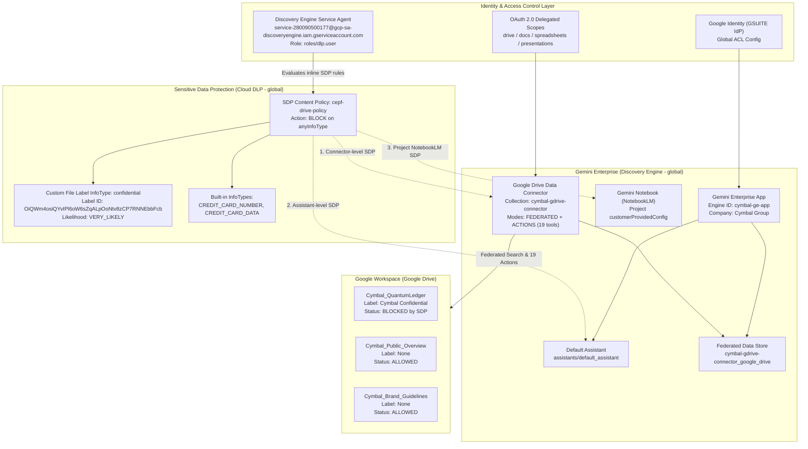
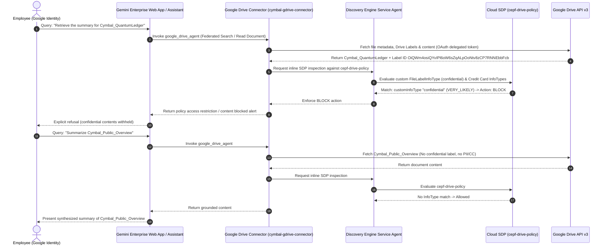

# Architecture & Security Design: Gemini Enterprise with Google Drive & Sensitive Data Protection (SDP)

## 1. Architectural Overview

Cymbal Group's enterprise knowledge architecture integrates **Gemini Enterprise (Google Cloud Discovery Engine)** with **Google Workspace (Google Drive)** via a **Federated Search and Actions Data Connector**, secured end-to-end by **Cloud Data Loss Prevention (Sensitive Data Protection / SDP)** content policies.

---

## 2. Defense-in-Depth Sensitive Data Protection (SDP) Layers

The architecture enforces `cepf-drive-policy` at three independent points in Gemini Enterprise:

| Enforcement Point | Resource Path | API Field | Purpose |
| :--- | :--- | :--- | :--- |
| **Layer 1: Data Connector** | `projects/{PROJECT_NUMBER}/locations/global/collections/cymbal-gdrive-connector/dataConnector` | `dataProtectionPolicy.sensitiveDataProtectionPolicy.policy` | Inspects and blocks sensitive/labeled Google Drive files (`Cymbal Confidential`) or credit card numbers during federated retrieval before content enters the LLM context. |
| **Layer 2: Gemini Assistant** | `projects/{PROJECT_NUMBER}/locations/global/collections/default_collection/engines/cymbal-ge-app/assistants/default_assistant` | `customerPolicy.dataProtectionPolicy.sensitiveDataProtectionPolicy.policy` | Inspects user prompts, grounding chunks, and assistant generation paths across all connected tools and data stores. |
| **Layer 3: Gemini Notebook** | `projects/{PROJECT_ID}` | `customerProvidedConfig.notebooklmConfig.dataProtectionPolicy.sensitiveDataProtectionPolicy.policy` | Enforces the same SDP policy in NotebookLM Enterprise when users attempt to import Drive documents or query sources containing `Cymbal Confidential` labels or credit card data. |

---

## 3. Data Flow & Policy Enforcement Sequence

---

## 4. Key Component Specifications

### 4.1 Identity & Access Management
- **Identity Provider**: Google Identity (`idpType: GSUITE`) configured on `projects/{PROJECT_ID}/locations/global/aclConfig`.
- **Service Agent**: `service-{PROJECT_NUMBER}@gcp-sa-discoveryengine.iam.gserviceaccount.com` granted `roles/dlp.user` so Discovery Engine can call Cloud DLP (`projects/{PROJECT_ID}/locations/global/contentPolicies/cepf-drive-policy`) at query time.

### 4.2 Google Drive Federated Connector (`cymbal-gdrive-connector`)
- **Mode**: `FEDERATED` + `ACTIONS` (no ingestion index storage latency; live search via Google Drive API).
- **Supported Actions Enabled (19 Actions)**:
  - `copy_file`, `create_file`, `download_file_content`, `get_cell_values`, `get_file_metadata`, `get_file_permissions`, `get_spreadsheet`, `insert_dimension`, `list_recent_files`, `list_shared_drives`, `read_document`, `read_file_content`, `read_presentation`, `search_files`, `share_file`, `trash_file`, `update_cell_values`, `update_file`, `update_formulas`.

### 4.3 Sensitive Data Protection Content Policy (`cepf-drive-policy`)
- **Custom File Label InfoType**:
  - Name: `confidential`
  - Likelihood: `VERY_LIKELY`
  - Sensitivity Score: `SENSITIVITY_UNSPECIFIED`
  - Google Drive Label ID: `OiQWm4osiQYvIPl6oW6sZqALpOoNtv8zCP7RNNEbbFcb` (`Cymbal Confidential`)
- **Built-in InfoTypes**:
  - `CREDIT_CARD_NUMBER`
  - `CREDIT_CARD_DATA`
- **Rule Action**:
  - Condition: `anyInfoType: {}`
  - Action: `BLOCK` (all `ALLOW` rules removed)
