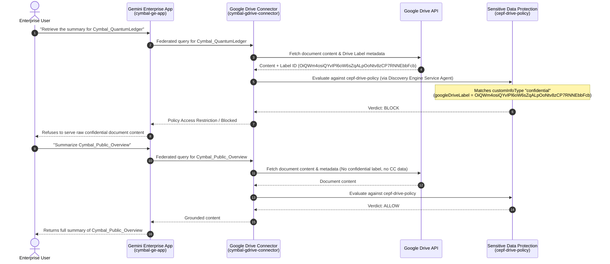

# [FDE] Add Google Drive with Sensitive Data Protection to Gemini Enterprise: Challenge Lab

Complete step-by-step documentation, architecture, automation scripts, and verification commands for the **[FDE] Add Google Drive with Sensitive Data Protection to Gemini Enterprise: Challenge Lab**.

---

## Table of Contents

1. [Executive Summary & Scenario](#1-executive-summary--scenario)
2. [Solution Architecture](#2-solution-architecture)
3. [Lab Configuration Reference](#3-lab-configuration-reference)
4. [Prerequisites & API Enablement](#4-prerequisites--api-enablement)
5. [Task 1: Configure the Gemini Enterprise App](#5-task-1-configure-the-gemini-enterprise-app)
6. [Task 2: Set Up a Data Connector for Google Drive](#6-task-2-set-up-a-data-connector-for-google-drive)
7. [Task 3: Test and Validate the Application](#7-task-3-test-and-validate-the-application)
8. [Task 4: Secure the Connected Infrastructure Using Custom Data Protection Policies](#8-task-4-secure-the-connected-infrastructure-using-custom-data-protection-policies)
9. [Task 5: Attach the SDP Policy to the Google Drive Connector](#9-task-5-attach-the-sdp-policy-to-the-google-enterprise-drive-connector)
10. [Task 6: Apply SDP to Assistant and Gemini Notebook](#10-task-6-apply-sdp-to-assistant-and-gemini-notebook)
11. [End-to-End Verification](#11-end-to-end-verification)
12. [Repository Structure](#12-repository-structure)

---

## 1. Executive Summary & Scenario

**Cymbal Group**, a multinational services organization, is rolling out **Gemini Enterprise** (powered by the Google Cloud Discovery Engine API) to unify knowledge discovery, operational efficiency, and cross-platform collaboration across enterprise systems such as Google Drive, Gmail, and Jira Cloud.

To ensure strict compliance with Cymbal Group's data governance standards, documents in Google Workspace classified with the **`Cymbal Confidential`** Drive label (`OiQWm4osiQYvIPl6oW6sZqALpOoNtv8zCP7RNNEbbFcb`) or containing payment card data (`CREDIT_CARD_NUMBER` / `CREDIT_CARD_DATA`) must be automatically blocked from AI retrieval, summarization, and direct user uploads.

### Key Objectives Accomplished

| Task | Objective | Key Resources Configured |
| :--- | :--- | :--- |
| **Task 1** | Configure Gemini Enterprise authentication & application | Global `aclConfig` (`idpType: GSUITE`), Engine `cymbal-ge-app` (`companyName: Cymbal Group`) |
| **Task 2** | Set up federated Google Drive connector with actions | Collection & DataConnector `cymbal-gdrive-connector` (`FEDERATED`, `ACTIONS`, all 19 Drive actions) |
| **Task 3** | Connect data store, populate sample Google Docs, and validate queries | Connected `cymbal-gdrive-connector_google_drive` to `cymbal-ge-app`; created `Cymbal_QuantumLedger`, `Cymbal_Public_Overview`, and `Cymbal_Brand_Guidelines` |
| **Task 4** | Apply Google Drive sensitivity label & create custom SDP policy | Labeled `Cymbal_QuantumLedger` with `OiQWm4osiQYvIPl6oW6sZqALpOoNtv8zCP7RNNEbbFcb`; created DLP Content Policy `cepf-drive-policy` (`BLOCK` on `anyInfoType`) |
| **Task 5** | Attach SDP policy to Google Drive connector & grant IAM permissions | Granted `roles/dlp.user` to Discovery Engine Service Agent; attached `cepf-drive-policy` to `cymbal-gdrive-connector` |
| **Task 6** | Apply SDP policy to Gemini Enterprise Assistant & Gemini Notebook | Attached `cepf-drive-policy` to `default_assistant` (`customerPolicy`) and project-level `notebooklmConfig` (`customerProvidedConfig`) |

---

## 2. Solution Architecture

### High-Level System Architecture

```mermaid
flowchart TB
    subgraph Workspace["Google Workspace (Identity & Data Source)"]
        IdP["Google Identity (GSUITE IdP)"]
        subgraph GDrive["Google Drive"]
            Doc1["Cymbal_QuantumLedger<br/>Label: Cymbal Confidential<br/>(OiQWm4osiQYvIPl6oW6sZqALpOoNtv8zCP7RNNEbbFcb)"]
            Doc2["Cymbal_Public_Overview<br/>(Unlabeled / Public)"]
            Doc3["Cymbal_Brand_Guidelines<br/>(Unlabeled / Public)"]
        end
    end

    subgraph GCP["Google Cloud Project (global)"]
        SA["Discovery Engine Service Agent<br/>service-PROJECT_NUMBER@gcp-sa-discoveryengine.iam.gserviceaccount.com<br/>Role: roles/dlp.user"]

        subgraph SDP["Cloud Data Loss Prevention / Sensitive Data Protection"]
            Policy["Content Policy: cepf-drive-policy<br/>- Custom File Label InfoType: confidential (VERY_LIKELY)<br/>- Built-in InfoTypes: CREDIT_CARD_NUMBER, CREDIT_CARD_DATA<br/>- Rule: Any InfoType -> Verdict: BLOCK"]
        end

        subgraph GE["Gemini Enterprise (Discovery Engine)"]
            ACL["Global ACL Config<br/>idpType: GSUITE"]
            Connector["Google Drive Connector<br/>cymbal-gdrive-connector<br/>Modes: FEDERATED + ACTIONS (19 tools)"]
            DS["Backing Data Store<br/>cymbal-gdrive-connector_google_drive"]
            Engine["Gemini Enterprise App (Engine)<br/>cymbal-ge-app<br/>Company: Cymbal Group"]
            Assistant["Default Assistant<br/>default_assistant<br/>(Upload Protection)"]
            Notebook["Gemini Notebook Enterprise<br/>notebooklmConfig<br/>(Project-Level Upload Protection)"]
        end
    end

    User(["Enterprise Employee"]) -->|1. Authenticates via OAuth / Google Identity| IdP
    IdP --> ACL
    User -->|2. Queries & Uploads Files| Engine
    Engine --> Assistant
    Engine --> DS
    DS --> Connector
    Connector <-->|3. Federated Search & Actions| GDrive

    SA -->|Evaluates Content & Labels| Policy
    Policy -.->|Inline SDP Enforcement (BLOCK Confidential)| Connector
    Policy -.->|Blocks Sensitive File Uploads| Assistant
    Policy -.->|Blocks Sensitive Source Uploads| Notebook
```

### Inline Sensitive Data Protection Enforcement Flow



---

## 3. Lab Configuration Reference

| Parameter | Value |
| :--- | :--- |
| **Location / Multi-Region** | `global` |
| **Identity Provider** | `Google Identity` (`GSUITE`) |
| **Gemini Enterprise App Name / ID** | `cymbal-ge-app` |
| **External Company Name** | `Cymbal Group` |
| **Connector Data Source** | `Google Drive` (`google_drive`) |
| **Connector / Collection ID** | `cymbal-gdrive-connector` |
| **Child Data Store ID** | `cymbal-gdrive-connector_google_drive` |
| **Connector Modes** | `FEDERATED`, `ACTIONS` |
| **Confidential Google Doc** | `Cymbal_QuantumLedger` |
| **Public Google Docs** | `Cymbal_Public_Overview`, `Cymbal_Brand_Guidelines` |
| **Google Workspace Label Name** | `Cymbal Confidential` |
| **Google Workspace Label ID** | `OiQWm4osiQYvIPl6oW6sZqALpOoNtv8zCP7RNNEbbFcb` |
| **SDP Content Policy ID** | `cepf-drive-policy` |
| **Custom InfoType Name** | `confidential` |
| **Custom InfoType Type** | `File Label` -> `Google Drive Label` |
| **Custom InfoType Likelihood** | `VERY_LIKELY` |
| **Built-in InfoTypes** | `CREDIT_CARD_NUMBER`, `CREDIT_CARD_DATA` |
| **Policy Rule Verdict** | `BLOCK` on `anyInfoType` |
| **Service Agent IAM Role** | `roles/dlp.user` on `service-PROJECT_NUMBER@gcp-sa-discoveryengine.iam.gserviceaccount.com` |

---

## 4. Prerequisites & API Enablement

Before executing the tasks, export your environment variables, enable the required Google Cloud APIs, and provision the Discovery Engine Service Agent identity:

```bash
export PROJECT_ID=$(gcloud config get-value project)
export PROJECT_NUMBER=$(gcloud projects describe "$PROJECT_ID" --format="value(projectNumber)")
export LOCATION="global"

# Enable required APIs
gcloud services enable \
  discoveryengine.googleapis.com \
  dlp.googleapis.com \
  drive.googleapis.com \
  docs.googleapis.com \
  drivelabels.googleapis.com \
  --project="$PROJECT_ID"

# Ensure the Discovery Engine Service Agent exists
gcloud beta services identity create \
  --service=discoveryengine.googleapis.com \
  --project="$PROJECT_ID"
```

---

## 5. Task 1: Configure the Gemini Enterprise App

In Task 1, you configure Google Identity (`GSUITE`) as the identity provider for the `global` location and create the `cymbal-ge-app` Gemini Enterprise application for `Cymbal Group`.

### Step 1.1: Configure Global Authentication Settings (`Google Identity`)

```bash
curl -X PATCH \
  -H "Authorization: Bearer $(gcloud auth print-access-token)" \
  -H "Content-Type: application/json" \
  -H "X-Goog-User-Project: ${PROJECT_ID}" \
  "https://discoveryengine.googleapis.com/v1alpha/projects/${PROJECT_ID}/locations/global/aclConfig" \
  -d '{
    "name": "projects/'"${PROJECT_ID}"'/locations/global/aclConfig",
    "idpConfig": {
      "idpType": "GSUITE"
    }
  }'
```

### Step 1.2: Create the Gemini Enterprise Application (`cymbal-ge-app`)

```bash
curl -X POST \
  -H "Authorization: Bearer $(gcloud auth print-access-token)" \
  -H "Content-Type: application/json" \
  -H "X-Goog-User-Project: ${PROJECT_ID}" \
  "https://discoveryengine.googleapis.com/v1alpha/projects/${PROJECT_ID}/locations/global/collections/default_collection/engines?engineId=cymbal-ge-app" \
  -d '{
    "displayName": "cymbal-ge-app",
    "solutionType": "SOLUTION_TYPE_SEARCH",
    "industryVertical": "GENERIC",
    "appType": "APP_TYPE_INTRANET",
    "searchEngineConfig": {
      "searchTier": "SEARCH_TIER_ENTERPRISE",
      "requiredSubscriptionTier": "SUBSCRIPTION_TIER_SEARCH_AND_ASSISTANT",
      "searchAddOns": ["SEARCH_ADD_ON_LLM"]
    },
    "commonConfig": {
      "companyName": "Cymbal Group"
    }
  }'
```

### Step 1.3: Verify Task 1

```bash
# Verify Global ACL Configuration
curl -s -H "Authorization: Bearer $(gcloud auth print-access-token)" \
  -H "X-Goog-User-Project: ${PROJECT_ID}" \
  "https://discoveryengine.googleapis.com/v1alpha/projects/${PROJECT_ID}/locations/global/aclConfig"

# Verify Gemini Enterprise App
curl -s -H "Authorization: Bearer $(gcloud auth print-access-token)" \
  -H "X-Goog-User-Project: ${PROJECT_ID}" \
  "https://discoveryengine.googleapis.com/v1alpha/projects/${PROJECT_ID}/locations/global/collections/default_collection/engines/cymbal-ge-app"
```

---

## 6. Task 2: Set Up a Data Connector for Google Drive

In Task 2, you ensure the minimum required delegated API permissions are configured in Google Workspace Admin Console, create the `cymbal-gdrive-connector` in `global` location using **Federated search** (`FEDERATED`) and **Actions** (`ACTIONS`), enable all 19 supported Google Drive actions, and connect the data store to `cymbal-ge-app`.

### Step 2.1: Delegated API Permissions (Google Workspace Admin Console)

Under **Security > Access and data control > API controls > Manage Domain Wide Delegation / App Access Control**, only the minimum required Google Drive OAuth scopes for federated search and actions are enabled:
- `https://www.googleapis.com/auth/drive`
- `https://www.googleapis.com/auth/drive.readonly`
- `https://www.googleapis.com/auth/drive.metadata.readonly`
- `https://www.googleapis.com/auth/drive.file`
- `https://www.googleapis.com/auth/drive.appdata`

### Step 2.2: Create the `cymbal-gdrive-connector` Data Connector

```bash
curl -X POST \
  -H "Authorization: Bearer $(gcloud auth print-access-token)" \
  -H "Content-Type: application/json" \
  -H "X-Goog-User-Project: ${PROJECT_ID}" \
  "https://discoveryengine.googleapis.com/v1alpha/projects/${PROJECT_ID}/locations/global:setUpDataConnector" \
  -d '{
    "collectionId": "cymbal-gdrive-connector",
    "collectionDisplayName": "cymbal-gdrive-connector",
    "dataConnector": {
      "dataSource": "google_drive",
      "entities": [
        {
          "entityName": "google_drive"
        }
      ],
      "connectorModes": [
        "FEDERATED",
        "ACTIONS"
      ]
    }
  }'
```

### Step 2.3: Enable All Supported Google Drive Actions on the Connector

```bash
curl -X PATCH \
  -H "Authorization: Bearer $(gcloud auth print-access-token)" \
  -H "Content-Type: application/json" \
  -H "X-Goog-User-Project: ${PROJECT_ID}" \
  "https://discoveryengine.googleapis.com/v1alpha/projects/${PROJECT_ID}/locations/global/collections/cymbal-gdrive-connector/dataConnector?updateMask=bap_config" \
  -d '{
    "bapConfig": {
      "supportedConnectorModes": ["ACTIONS"],
      "enabledActions": [
        "copy_file",
        "create_file",
        "download_file_content",
        "get_cell_values",
        "get_file_metadata",
        "get_file_permissions",
        "get_spreadsheet",
        "insert_dimension",
        "list_recent_files",
        "list_shared_drives",
        "read_document",
        "read_file_content",
        "read_presentation",
        "search_files",
        "share_file",
        "trash_file",
        "update_cell_values",
        "update_file",
        "update_formulas"
      ]
    }
  }'
```

### Step 2.4: Connect the Data Store (`cymbal-gdrive-connector_google_drive`) to `cymbal-ge-app`

> **Note:** When linking a single data store via the Discovery Engine REST API, creating (or recreating) the Engine with `"dataStoreIds": ["cymbal-gdrive-connector_google_drive"]` links the backing data store `projects/${PROJECT_NUMBER}/locations/global/collections/default_collection/dataStores/cymbal-gdrive-connector_google_drive` directly to `cymbal-ge-app`.

```bash
# If cymbal-ge-app was created prior to the data store without dataStoreIds, recreate it with dataStoreIds linked:
curl -X DELETE \
  -H "Authorization: Bearer $(gcloud auth print-access-token)" \
  -H "X-Goog-User-Project: ${PROJECT_ID}" \
  "https://discoveryengine.googleapis.com/v1alpha/projects/${PROJECT_ID}/locations/global/collections/default_collection/engines/cymbal-ge-app"

sleep 3

curl -X POST \
  -H "Authorization: Bearer $(gcloud auth print-access-token)" \
  -H "Content-Type: application/json" \
  -H "X-Goog-User-Project: ${PROJECT_ID}" \
  "https://discoveryengine.googleapis.com/v1alpha/projects/${PROJECT_ID}/locations/global/collections/default_collection/engines?engineId=cymbal-ge-app" \
  -d '{
    "displayName": "cymbal-ge-app",
    "dataStoreIds": [
      "cymbal-gdrive-connector_google_drive"
    ],
    "solutionType": "SOLUTION_TYPE_SEARCH",
    "industryVertical": "GENERIC",
    "appType": "APP_TYPE_INTRANET",
    "searchEngineConfig": {
      "searchTier": "SEARCH_TIER_ENTERPRISE",
      "requiredSubscriptionTier": "SUBSCRIPTION_TIER_SEARCH_AND_ASSISTANT",
      "searchAddOns": ["SEARCH_ADD_ON_LLM"]
    },
    "commonConfig": {
      "companyName": "Cymbal Group"
    }
  }'
```

---

## 7. Task 3: Test and Validate the Application

In Task 3, you confirm `cymbal-gdrive-connector` is connected to `cymbal-ge-app`, create the three sample Google Docs in Google Drive, and validate search and summarization via Gemini Enterprise.

### Step 3.1: Create the Three Sample Google Docs in Google Drive via Drive v3 API

```bash
python3 - << 'EOF'
import json, subprocess, urllib.request

project_id = subprocess.check_output(["gcloud", "config", "get-value", "project"]).decode().strip()
token = subprocess.check_output(["gcloud", "auth", "print-access-token"]).decode().strip()

docs = [
    (
        "Cymbal_QuantumLedger",
        """Financial Overview - Cymbal Group

Executive Summary:

Q4 2023 showed strong revenue growth driven by strategic acquisitions and increased market share in the security consulting division.

Financial Details:

Revenue Breakdown:

- Professional Services: $4.2M (up 15% YoY)
- Technology Solutions: $2.8M (up 12% YoY)
- Managed Services: $1.5M (up 8% YoY)

Key Highlights:

- Successfully integrated acquired assets, achieving cost synergies ahead of schedule
- Expanded market presence in APAC region, capturing 5% market share
- Improved operational efficiency through automation initiatives

Strategic Outlook:

- Continued investment in AI-powered solutions to enhance service offerings
- Focus on expanding managed services portfolio for recurring revenue
- Explore strategic partnerships to accelerate growth in emerging markets

Risk Factors:

- Global economic uncertainties may impact client spending
- Increased competition in technology solutions segment
- Regulatory changes in data privacy could affect operations"""
    ),
    (
        "Cymbal_Public_Overview",
        """Cymbal Group - Public Overview

Cymbal Group is a premier technology services and consulting organization. We work with enterprises worldwide to deliver state-of-the-art cloud architecture, data platform development, and managed infrastructure services.

Our team focuses on open standard technologies, security-first patterns, and reliable cloud operations."""
    ),
    (
        "Cymbal_Brand_Guidelines",
        """Cymbal Group - Brand Guidelines

Our Brand Tone and Voice:
- Professional: We use clear, direct, and helpful language.
- Collaborative: We emphasize teamwork, partnership, and working together to solve problems.
- Innovative: We look forward and think about modern cloud-native capabilities.

Please follow these guidelines for all public-facing communication materials."""
    )
]

boundary = "===multipart_boundary_12345==="

for name, content in docs:
    metadata = json.dumps({
        "name": name,
        "mimeType": "application/vnd.google-apps.document"
    })
    body = (
        f"--{boundary}\r\n"
        f"Content-Type: application/json; charset=UTF-8\r\n\r\n"
        f"{metadata}\r\n"
        f"--{boundary}\r\n"
        f"Content-Type: text/plain; charset=UTF-8\r\n\r\n"
        f"{content}\r\n"
        f"--{boundary}--\r\n"
    ).encode("utf-8")

    req = urllib.request.Request(
        "https://www.googleapis.com/upload/drive/v3/files?uploadType=multipart",
        data=body,
        headers={
            "Authorization": f"Bearer {token}",
            "X-Goog-User-Project": project_id,
            "Content-Type": f"multipart/related; boundary={boundary}"
        },
        method="POST"
    )
    with urllib.request.urlopen(req) as resp:
        print(f"Created {name}:", json.loads(resp.read().decode()))
EOF
```

### Step 3.2: Query and Validate via `streamAssist` API (or Web App UI)

```bash
# Query 1: List all the Drive documents
curl -s -X POST \
  -H "Authorization: Bearer $(gcloud auth print-access-token)" \
  -H "Content-Type: application/json" \
  -H "X-Goog-User-Project: ${PROJECT_ID}" \
  "https://discoveryengine.googleapis.com/v1alpha/projects/${PROJECT_ID}/locations/global/collections/default_collection/engines/cymbal-ge-app/assistants/default_assistant:streamAssist" \
  -d '{
    "query": {
      "text": "List all the Drive documents."
    },
    "toolsSpec": {
      "vertexAiSearchSpec": {
        "dataStoreSpecs": [
          {
            "dataStore": "projects/'"${PROJECT_NUMBER}"'/locations/global/collections/default_collection/dataStores/cymbal-gdrive-connector_google_drive"
          }
        ]
      }
    }
  }'

# Query 2: Summarize Cymbal_QuantumLedger financial allocations (before SDP policy is attached)
curl -s -X POST \
  -H "Authorization: Bearer $(gcloud auth print-access-token)" \
  -H "Content-Type: application/json" \
  -H "X-Goog-User-Project: ${PROJECT_ID}" \
  "https://discoveryengine.googleapis.com/v1alpha/projects/${PROJECT_ID}/locations/global/collections/default_collection/engines/cymbal-ge-app/assistants/default_assistant:streamAssist" \
  -d '{
    "query": {
      "text": "Summarize the financial allocations for Cymbal_QuantumLedger from Google Drive and present them as a bulleted list"
    },
    "toolsSpec": {
      "vertexAiSearchSpec": {
        "dataStoreSpecs": [
          {
            "dataStore": "projects/'"${PROJECT_NUMBER}"'/locations/global/collections/default_collection/dataStores/cymbal-gdrive-connector_google_drive"
          }
        ]
      }
    }
  }'

# Query 3: Summarize Cymbal_Public_Overview
curl -s -X POST \
  -H "Authorization: Bearer $(gcloud auth print-access-token)" \
  -H "Content-Type: application/json" \
  -H "X-Goog-User-Project: ${PROJECT_ID}" \
  "https://discoveryengine.googleapis.com/v1alpha/projects/${PROJECT_ID}/locations/global/collections/default_collection/engines/cymbal-ge-app/assistants/default_assistant:streamAssist" \
  -d '{
    "query": {
      "text": "Summarize the details of Cymbal_Public_Overview from Google Drive"
    },
    "toolsSpec": {
      "vertexAiSearchSpec": {
        "dataStoreSpecs": [
          {
            "dataStore": "projects/'"${PROJECT_NUMBER}"'/locations/global/collections/default_collection/dataStores/cymbal-gdrive-connector_google_drive"
          }
        ]
      }
    }
  }'
```

---

## 8. Task 4: Secure the Connected Infrastructure Using Custom Data Protection Policies

In Task 4, you apply the **`Cymbal Confidential`** Google Workspace Drive label (`OiQWm4osiQYvIPl6oW6sZqALpOoNtv8zCP7RNNEbbFcb`) to `Cymbal_QuantumLedger` and create a Sensitive Data Protection (Cloud DLP) content policy named `cepf-drive-policy` in the `global` location.

### Step 4.1: Apply the `Cymbal Confidential` Drive Label to `Cymbal_QuantumLedger`

```bash
export QUANTUM_FILE_ID=$(curl -s \
  -H "Authorization: Bearer $(gcloud auth print-access-token)" \
  -H "X-Goog-User-Project: ${PROJECT_ID}" \
  "https://www.googleapis.com/drive/v3/files?q=name='Cymbal_QuantumLedger'+and+trashed=false&fields=files(id,name)" \
  | python3 -c "import sys, json; print(json.load(sys.stdin)['files'][0]['id'])")

curl -X POST \
  -H "Authorization: Bearer $(gcloud auth print-access-token)" \
  -H "Content-Type: application/json" \
  -H "X-Goog-User-Project: ${PROJECT_ID}" \
  "https://www.googleapis.com/drive/v3/files/${QUANTUM_FILE_ID}/modifyLabels" \
  -d '{
    "labelModifications": [
      {
        "labelId": "OiQWm4osiQYvIPl6oW6sZqALpOoNtv8zCP7RNNEbbFcb",
        "removeLabel": false
      }
    ]
  }'
```

### Step 4.2: Create the Custom SDP Content Policy (`cepf-drive-policy`)

```bash
curl -X POST \
  -H "Authorization: Bearer $(gcloud auth print-access-token)" \
  -H "Content-Type: application/json" \
  -H "X-Goog-User-Project: ${PROJECT_ID}" \
  "https://dlp.googleapis.com/v2/projects/${PROJECT_ID}/locations/global/contentPolicies" \
  -d '{
    "contentPolicyId": "cepf-drive-policy",
    "contentPolicy": {
      "displayName": "cepf-drive-policy",
      "inspectConfig": {
        "infoTypes": [
          {
            "name": "CREDIT_CARD_NUMBER"
          },
          {
            "name": "CREDIT_CARD_DATA"
          }
        ],
        "customInfoTypes": [
          {
            "infoType": {
              "name": "confidential"
            },
            "likelihood": "VERY_LIKELY",
            "fileLabelInfoType": {
              "googleDriveLabel": {
                "labelId": "OiQWm4osiQYvIPl6oW6sZqALpOoNtv8zCP7RNNEbbFcb"
              }
            }
          }
        ]
      },
      "rules": [
        {
          "conditions": [
            {
              "infoTypeCondition": {
                "anyInfoType": {}
              }
            }
          ],
          "action": {
            "returnVerdict": "BLOCK"
          }
        }
      ]
    }
  }'
```

---

## 9. Task 5: Attach the SDP Policy to the Google Drive Connector

In Task 5, you grant the `DLP User` (`roles/dlp.user`) IAM role to the Discovery Engine Service Agent and attach `cepf-drive-policy` directly to the `cymbal-gdrive-connector` data connector.

### Step 5.1: Grant `roles/dlp.user` to the Discovery Engine Service Agent

```bash
gcloud projects add-iam-policy-binding "${PROJECT_ID}" \
  --member="serviceAccount:service-${PROJECT_NUMBER}@gcp-sa-discoveryengine.iam.gserviceaccount.com" \
  --role="roles/dlp.user"
```

### Step 5.2: Attach `cepf-drive-policy` to `cymbal-gdrive-connector`

```bash
curl -X PATCH \
  -H "Authorization: Bearer $(gcloud auth print-access-token)" \
  -H "Content-Type: application/json" \
  -H "X-Goog-User-Project: ${PROJECT_ID}" \
  "https://discoveryengine.googleapis.com/v1alpha/projects/${PROJECT_ID}/locations/global/collections/cymbal-gdrive-connector/dataConnector?updateMask=data_protection_policy" \
  -d '{
    "dataProtectionPolicy": {
      "sensitiveDataProtectionPolicy": {
        "policy": "projects/'"${PROJECT_ID}"'/locations/global/contentPolicies/cepf-drive-policy"
      }
    }
  }'
```

---

## 10. Task 6: Apply SDP to Assistant and Gemini Notebook

In Task 6, you enforce `cepf-drive-policy` on direct file uploads to the **Gemini Enterprise Assistant** (`default_assistant`) and **Gemini Notebook Enterprise** (`notebooklmConfig`).

### Step 6.1: Attach `cepf-drive-policy` to the Gemini Enterprise Assistant (`default_assistant`)

```bash
curl -X PATCH \
  -H "Authorization: Bearer $(gcloud auth print-access-token)" \
  -H "Content-Type: application/json" \
  -H "X-Goog-User-Project: ${PROJECT_ID}" \
  "https://discoveryengine.googleapis.com/v1alpha/projects/${PROJECT_ID}/locations/global/collections/default_collection/engines/cymbal-ge-app/assistants/default_assistant?updateMask=customer_policy" \
  -d '{
    "customerPolicy": {
      "dataProtectionPolicy": {
        "sensitiveDataProtectionPolicy": {
          "policy": "projects/'"${PROJECT_ID}"'/locations/global/contentPolicies/cepf-drive-policy"
        }
      }
    }
  }'
```

### Step 6.2: Attach `cepf-drive-policy` to Gemini Notebook Enterprise (`notebooklmConfig`)

```bash
curl -X PATCH \
  -H "Authorization: Bearer $(gcloud auth print-access-token)" \
  -H "Content-Type: application/json" \
  -H "X-Goog-User-Project: ${PROJECT_ID}" \
  "https://discoveryengine.googleapis.com/v1alpha/projects/${PROJECT_ID}?updateMask=customer_provided_config" \
  -d '{
    "customerProvidedConfig": {
      "notebooklmConfig": {
        "dataProtectionPolicy": {
          "sensitiveDataProtectionPolicy": {
            "policy": "projects/'"${PROJECT_ID}"'/locations/global/contentPolicies/cepf-drive-policy"
          }
        }
      }
    }
  }'
```

---

## 11. End-to-End Verification

Run `./scripts/verify_all_tasks.sh` to validate all configured resources across Tasks 1 through 6:

```bash
bash scripts/verify_all_tasks.sh
```

---

## 12. Repository Structure

```text
.
├── README.md                                           # Complete step-by-step guide, commands, and summary
├── ARCHITECTURE.md                                     # Deep-dive system & security architecture documentation
└── scripts/
    ├── task1_configure_gemini_enterprise_app.sh        # Task 1: Global ACL config + cymbal-ge-app creation
    ├── task2_setup_gdrive_connector.sh                 # Task 2: cymbal-gdrive-connector + 19 Drive actions
    ├── task3_create_drive_docs_and_connect.py          # Task 3: Create 3 Google Docs in Drive & link data store
    ├── task4_label_and_create_sdp_policy.sh            # Task 4: Apply Drive label + create cepf-drive-policy
    ├── task5_attach_sdp_to_connector.sh                # Task 5: Grant DLP User role + attach policy to connector
    ├── task6_apply_sdp_to_assistant_and_notebook.sh    # Task 6: Attach policy to Assistant & NotebookLM
    └── verify_all_tasks.sh                             # End-to-end verification script for all 6 tasks
```
